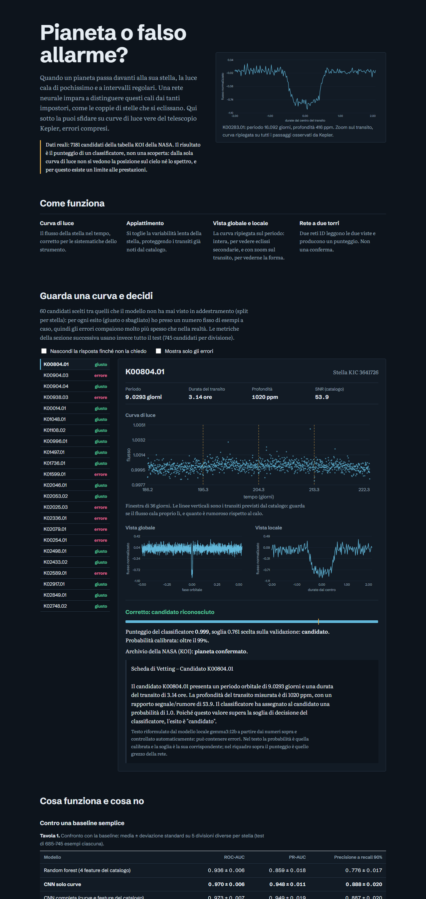
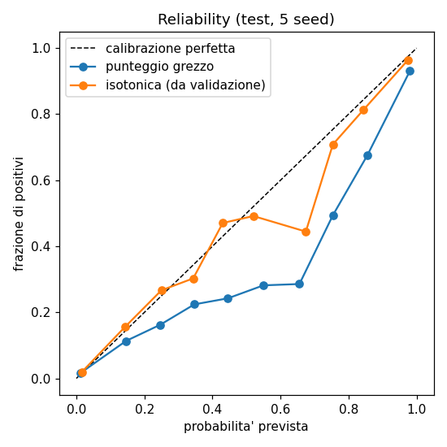

<!-- GENERATO da docs/templates/README.md.tmpl con scripts/render_docs.py a partire da docs/results/*.json.
     Non modificare a mano: modifica il modello e rigenera. -->
# exoplanet-transit-cnn


Una rete neurale che distingue **candidati esopianeta** da **falsi positivi** a partire dalle curve di luce del telescopio
Kepler, con una valutazione onesta di dove funziona e dove no. Progetto personale di portfolio, ispirato ad AstroNet
(Shallue & Vanderburg 2018) ma riscritto da zero e molto più piccolo.



## In breve
Quando un pianeta passa davanti alla sua stella, la luce cala di poco e a intervalli regolari (un *transito*). Molti segnali
simili non sono pianeti ma **falsi positivi**: coppie di stelle che si eclissano, stelle di fondo, variabilità stellare,
sistematiche dello strumento. Scegliere tra i due casi si chiama *vetting* ed è il compito del modello.

- **Dati reali**: 7181 candidati (KOI) da 6294 stelle Kepler, di cui 2709 confermati e
  4472 falsi positivi secondo la tabella della NASA; poi 1543 candidati TESS per il trasferimento.
- **Modello**: CNN a due torri (vista globale e vista locale della curva ripiegata sul periodo), 401.377 parametri.
- **Valutazione**: split sempre per stella, soglia scelta sulla validazione, 5 seed con media ± deviazione standard,
  baseline random forest, controlli con etichette permutate.
- **Demo**: sito statico in `web/` con 60 candidati veri (errori compresi) e una modalità "indovina".

| Modello | ROC-AUC | PR-AUC | Precisione a recall 90% |
| --- | ---: | ---: | ---: |
| Random forest (4 feature del catalogo) | 0.936 ± 0.006 | 0.859 ± 0.018 | 0.776 ± 0.017 |
| CNN solo curve | 0.970 ± 0.006 | 0.948 ± 0.011 | 0.888 ± 0.020 |
| CNN completa (curve + feature del catalogo) | 0.973 ± 0.007 | 0.949 ± 0.019 | 0.887 ± 0.020 |
| CNN solo vista locale | 0.963 ± 0.010 | 0.941 ± 0.014 | 0.844 ± 0.038 |
| CNN solo vista globale | 0.958 ± 0.006 | 0.928 ± 0.014 | 0.813 ± 0.032 |

*Media ± deviazione standard su 5 divisioni per stella (test di 685–745 esempi ciascuna). Fonte: `docs/results/kepler_cnn_summary.json`.*

La CNN solo curve supera la random forest in 5 su 5 divisioni (differenza di PR-AUC +0.089 ± 0.020). Le feature
del catalogo non aggiungono nulla di misurabile: le curve bastano. **Ma** un classificatore sulla sola curva di luce non vede la
posizione del segnale sul cielo, né spettri né immagini: molti falsi positivi hanno un transito pulito, identico a quello di un
pianeta, e il modello non può distinguerli. Un punteggio alto è un candidato da verificare, non una scoperta.

## Dove funziona e dove no
- **Funziona bene** per periodi medi (recall 0.92–0.93 tra 3 e 100 giorni), profondità e SNR medio-alti.
- **Sbaglia** sui periodi brevi (recall 0.47 su 34 positivi, periodi fino a 1.5 giorni),
  sui dip molto profondi (oltre 10000 ppm: recall 0.68, ma solo 28 positivi su
  672 esempi, quasi tutti binarie a eclisse) e a SNR basso (recall 0.33 per SNR 7.1–10).
- **Completezza con transiti iniettati** in curve reali tranquille (2506 iniezioni valide su 2520): scende
  a 0.41 nella cella peggiore (200 ppm e 128 giorni); mediana delle celle 0.98. Con effemeride nota: si
  misura il classificatore, non la ricerca del periodo.

| Profondità \ periodo (giorni) | 2 | 4 | 8 | 16 | 32 | 64 | 128 |
| --- | ---: | ---: | ---: | ---: | ---: | ---: | ---: |
| 200 ppm | 0.93 | 0.88 | 0.88 | 0.80 | 0.71 | 0.67 | 0.41 |
| 500 ppm | 0.98 | 0.97 | 0.95 | 0.88 | 0.85 | 0.87 | 0.83 |
| 1000 ppm | 1.00 | 0.98 | 0.98 | 0.98 | 0.92 | 0.93 | 0.85 |
| 2000 ppm | 1.00 | 1.00 | 1.00 | 0.97 | 0.98 | 0.93 | 0.92 |
| 5000 ppm | 1.00 | 1.00 | 1.00 | 1.00 | 1.00 | 0.95 | 0.97 |
| 10000 ppm | 1.00 | 1.00 | 0.98 | 1.00 | 1.00 | 1.00 | 1.00 |



- **Calibrazione**: il punteggio grezzo non è una probabilità (errore di calibrazione 0.055 ± 0.010); dopo una calibrazione
  isotonica sulla validazione scende a 0.024 ± 0.007. Scegliendo sulla validazione la soglia per un recall di 0.90 si ottiene sul
  test recall 0.887 ± 0.022 e precisione 0.892 ± 0.019.
- **Robustezza** (soglia fissa scelta su dati puliti): con meno dati o più rumore il modello diventa più prudente e perde recall.

| Perturbazione | KOI tenuti | PR-AUC | Recall | Precisione |
| --- | ---: | ---: | ---: | ---: |
| Originale | 713/713 | 0.948 ± 0.011 | 0.897 ± 0.012 | 0.883 |
| Primi 730 d | 664/713 | 0.931 ± 0.019 | 0.793 ± 0.016 | 0.904 |
| Primi 365 d | 636/713 | 0.898 ± 0.020 | 0.643 ± 0.036 | 0.912 |
| Rumore x2 | 713/713 | 0.883 ± 0.027 | 0.623 ± 0.038 | 0.897 |
| Rumore x4 | 713/713 | 0.741 ± 0.057 | 0.336 ± 0.022 | 0.870 |

## Un altro telescopio: TESS
Il modello addestrato solo su Kepler, senza vedere TESS, ha ROC-AUC 0.837 ± 0.014 su 148–158 candidati di
test (0.827–0.848 su tutti i 1543): il trasferimento perde rispetto a Kepler ma batte una random
forest. Affinarlo su TESS non è distinguibile dal modello così com'è (PR-AUC +0.026 ± 0.033, migliore in
4 su 5 divisioni) né da una rete addestrata solo su TESS (+0.012 ± 0.063).

| Approccio | ROC-AUC | PR-AUC | Precisione a recall 90% |
| --- | ---: | ---: | ---: |
| Modello Kepler così com'è | 0.837 ± 0.014 | 0.840 ± 0.035 | 0.762 ± 0.018 |
| Modello Kepler affinato su TESS | 0.868 ± 0.035 | 0.866 ± 0.057 | 0.780 ± 0.028 |
| CNN addestrata solo su TESS | 0.826 ± 0.034 | 0.855 ± 0.038 | 0.711 ± 0.037 |
| Random forest (3 feature) | 0.725 ± 0.027 | 0.742 ± 0.043 | 0.675 ± 0.012 |

*Sottoinsieme di TESS: 1543 candidati da 1456 stelle (836 positivi e 707 negativi); il download si è fermato quando il disco si è riempito.*

## Come funziona
```
curva di luce Kepler (PDCSAP) ──► appiattimento (mediana mobile, transiti noti mascherati)
        ──► ripiegamento sul periodo del catalogo ──► vista globale (intera orbita) + vista locale (zoom sul transito)
        ──► CNN a due torri ──► punteggio ──► soglia scelta sulla validazione ──► candidato / scartato
```
Le effemeridi (periodo, epoca, durata) sono quelle della tabella KOI della NASA: il modello classifica segnali già trovati, non
li cerca. I transiti degli altri KOI della stessa stella vengono eliminati prima del ripiegamento.

## Metodo e controlli
- Split **sempre per stella** (più candidati della stessa stella in split diversi gonfierebbero le metriche).
- Soglia e arresto anticipato scelti sulla validazione, mai sul test; metriche con PR-AUC, ROC-AUC, precisione a recall 90% e
  dimensione del test, mai la sola accuratezza.
- 5 seed, ciascuno con il suo split; la differenza CNN − baseline è appaiata per seed.
- Controllo con etichette permutate tra stelle: ROC-AUC 0.487 ± 0.020 per la CNN e 0.494 ± 0.019 per la random forest
  (devono essere ~0.5). Stesso controllo su TESS: 0.566 ± 0.064.
- Il solo SNR, usato come punteggio, non separa le classi (ROC-AUC 0.491, intervallo 0.447–0.534):
  le binarie a eclisse hanno SNR enormi.

## Limiti
- Solo curva di luce: tetto alle prestazioni. Le etichette KOI/TOI sono decisioni di gruppi di ricerca e contengono errori.
- Test di poche centinaia di esempi, iperparametri non ottimizzati, una sola famiglia di modelli. Differenze piccole non sono
  significative. La GPU non è deterministica: la stessa configurazione dà medie leggermente diverse tra due esecuzioni.
- Nessuna iniezione di falsi positivi (solo completezza), rumore di test gaussiano bianco, nessun test su altri cataloghi.
- Le schede di testo (modello locale `gemma3:12b` via Ollama, a partire da numeri già calcolati) passano controlli automatici
  (98% di schede segnalate con i dati come JSON, 0% con righe etichettate, su 50), ma i difetti
  più gravi li ho trovati leggendo a mano: i controlli sono euristiche.
- Nessun deploy pubblico verificato della demo; layout controllato solo in tema scuro e non su schermi stretti.

## Riprodurre
Richiede Python 3.10+; per la GPU un driver NVIDIA recente. PyTorch non è tra le dipendenze del pacchetto: installa la build giusta
da https://pytorch.org/get-started/locally/ prima del resto.
```
python -m venv .venv && source .venv/bin/activate        # Windows: .venv\Scripts\activate
pip install -e ".[dev,kepler]"
python scripts/check_env.py && pytest

# dati Kepler (ore e ~3 GB; riprendibile) e dataset
python scripts/download_kepler.py --workers 8
python scripts/build_dataset.py --source kepler --koi data/raw/koi.csv --cache data/raw/kepler \
    --out data/processed/kepler.npz --report reports/kepler_dataset.json
# baseline, CNN (5 seed, 4 varianti), analisi
python scripts/baselines.py --data data/processed/kepler.npz --report reports/kepler_baselines.json
python scripts/run_cnn_experiments.py --data data/processed/kepler.npz --report reports/kepler_cnn.json --models-dir models/kepler
python scripts/analyze_errors.py --data data/processed/kepler.npz
python scripts/injection_recovery.py --data data/processed/kepler.npz
python scripts/robustness.py --data data/processed/kepler.npz
# TESS
python scripts/download_tess.py --workers 8
python scripts/build_dataset.py --source tess --toi data/raw/toi.csv --cache data/raw/tess --min-transits 2 \
    --out data/processed/tess.npz --report reports/tess_dataset.json
python scripts/run_tess_transfer.py --data data/processed/tess.npz --report reports/tess_transfer.json
# schede, demo web, documenti
python scripts/generate_vetting_texts.py --data data/processed/kepler.npz
python scripts/export_web_data.py --data data/processed/kepler.npz && python scripts/check_demo.py --data data/processed/kepler.npz
python scripts/snapshot_results.py && python scripts/render_docs.py
cd web && npm install && npm run dev
```
Percorso sintetico per provare il codice senza scaricare nulla: `python scripts/build_dataset.py --source synthetic --n 300 --out
data/processed/synthetic.npz` e `scripts/train.py` (vedi `CLAUDE.md`). Dati e pesi non sono nel git.

## Struttura
```
src/exotransit/   preprocess  koi  toi  model  experiments  baselines  metrics  perturb  transfer  llm  webdata  ...
scripts/          download_*  build_dataset  run_*  analyze_errors  injection_recovery  robustness  export_web_data  ...
web/              demo statica (Vite + React), legge web/public/data/demo.json
docs/             MODEL_CARD  POST  ROADMAP  SCIENCE_NOTES  DEPLOY_VERCEL  results/ (snapshot dei report)  templates/
tests/            un file per area, senza rete e senza dati reali
```

## Documenti
[Model card](docs/MODEL_CARD.md) · [Riassunto di una pagina](docs/POST.md) · [Roadmap e diario dei risultati](docs/ROADMAP.md) ·
[Note scientifiche e riferimenti verificati](docs/SCIENCE_NOTES.md) · [Deploy della demo](docs/DEPLOY_VERCEL.md) ·
[Regole del progetto](CLAUDE.md). README, model card e riassunto sono **generati** dagli snapshot in `docs/results/`:
nessun numero è scritto a mano (`python scripts/render_docs.py --check` verifica che siano aggiornati).

## Licenza
Nessuna licenza scelta finora: tutti i diritti riservati finché non ne viene aggiunta una. Dati: NASA Exoplanet Archive e MAST.
